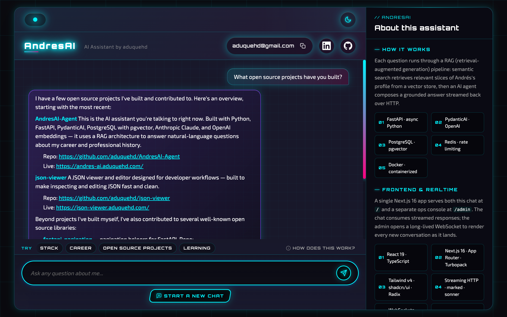
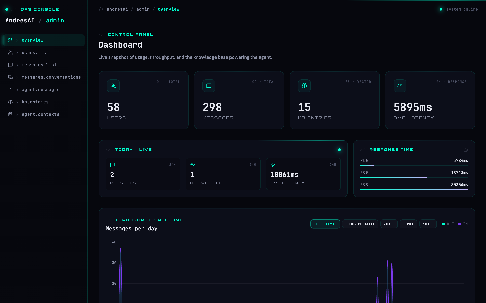
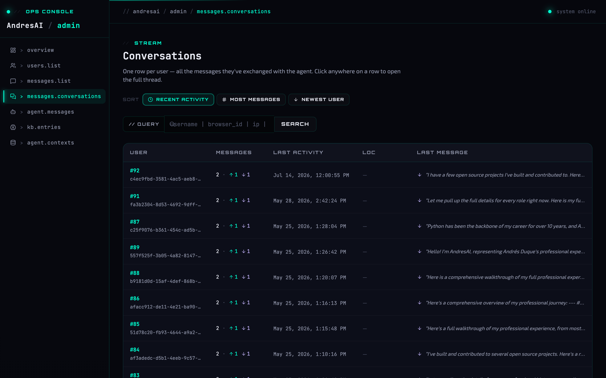
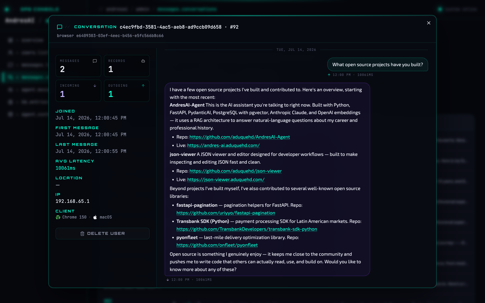

<div align="center">

# 🤖 AndresAI — App (Frontend)

<a href="https://andres-ai.aduquehd.com/">
  
</a>

[](https://nextjs.org/)
[](https://react.dev/)
[](https://www.typescriptlang.org/)
[](https://tailwindcss.com/)
[](https://vercel.com/)

**Next.js 16 frontend for AndresAI — serves both the chat UI at `/` and the admin at `/admin`.**

[Companion repo](#-companion-repo) • [Features](#-features) • [Screenshots](#-screenshots) • [Stack](#-stack) • [Quick Start](#-quick-start) • [Routes](#-routes) • [Deployment](#-deployment) • [Contributing](#-contributing)

</div>

---

## 🔗 Companion repo

This is the **frontend** half of AndresAI. The project was originally a single repo and has since been split:

- **Frontend (this repo)** — [`andres-ai-agent-app`](https://github.com/aduquehd/andres-ai-agent-app): Next.js 16 on Vercel. Chat UI at `/`, admin UI at `/admin`.
- **Backend** — [`AndresAI-Agent`](https://github.com/aduquehd/AndresAI-Agent): FastAPI, PostgreSQL/pgvector, Redis. Deployed via Docker on a server.

The frontend talks to the backend over HTTPS — you must run the [backend repo](https://github.com/aduquehd/AndresAI-Agent) locally (or point at a deployed instance) for chat and admin to work. The backend URL is configured via `NEXT_PUBLIC_API_URL`.

## ✨ Features

- 💬 **Streaming chat UI** — cyberpunk-themed, renders the backend's newline-delimited JSON stream as it arrives, with a stop-generation control
- 📊 **Admin dashboard** — stats with range filters (`this month`, 30/60/90 days, all time) and charts built with Recharts
- 🗂️ **Conversations view** — browse full chat threads grouped per user
- 📡 **Real-time updates** — the admin subscribes to the backend's WebSocket (`/api/admin/ws`) so new users/messages appear live, no refresh needed
- 🧠 **Knowledge base & agent context editors** — manage the agent's RAG entries and system prompt; the backend re-embeds on save
- 👤 **User management** — user details modal with per-user stats, cascade delete with custom confirmation modals

## 📸 Screenshots

### Chat

The cyberpunk-themed chat UI streaming an answer about open source projects:



### Admin — Dashboard

Live usage stats, latency percentiles, throughput charts, and geography:



### Admin — Conversations

One row per user with message counts, last activity, and a preview of the last message:



### Admin — Conversation detail

Clicking a row opens the full thread with per-user metadata (latency, client, IP, geo):



## 🧰 Stack

- **Next.js 16** (App Router, Turbopack, React 19)
- **TypeScript 6**
- **Tailwind v4** + **shadcn/ui** (Radix-based, Nova preset)
- **Recharts** for admin charts, **sonner** for toasts
- **marked** for chat message rendering
- **pnpm** as the package manager (pinned via `packageManager` in `package.json`)

> ⚠️ This project uses **Next.js 16** — APIs, conventions, and file structure differ from earlier major versions. See `AGENTS.md`.

## 🚀 Quick Start

### 1️⃣ Clone

```bash
git clone git@github.com:aduquehd/andres-ai-agent-app.git
cd andres-ai-agent-app
```

### 2️⃣ Install pnpm (once)

```bash
npm install -g pnpm
# or
corepack enable && corepack prepare pnpm@latest --activate
```

### 3️⃣ Configure

```bash
cp .env.local.example .env.local
```

```dotenv
# Public URL of the FastAPI backend (andres-ai-api).
# Local dev:    http://localhost:8000
# Production:   your deployed API origin, no trailing slash
NEXT_PUBLIC_API_URL=http://localhost:8000

# Optional — Google Analytics tracking ID, applied only to the chat route.
# NEXT_PUBLIC_GA_TRACKING_ID=G-XXXXXXXXXX
```

### 4️⃣ Run the backend (separate repo)

The frontend won't do anything useful without the backend running. In another terminal:

```bash
git clone git@github.com:aduquehd/AndresAI-Agent.git
cd AndresAI-Agent
# Follow the backend's README — copy .env.example, then:
docker compose up
```

### 5️⃣ Run the frontend

```bash
pnpm install
pnpm dev
```

Open <http://localhost:3000/> for the chat or <http://localhost:3000/admin> for the admin.

## 🗺️ Routes

| Path                          | What it is                                                                 |
|-------------------------------|----------------------------------------------------------------------------|
| `/`                           | Chat UI (route group `(chat)`). Cyberpunk CSS + Orbitron/Exo 2 fonts.      |
| `/admin`                      | Admin dashboard — stats, range filter, charts. Wrapped in `AdminShell`, enforces auth. |
| `/admin/login`                | Admin login (sibling of `(dashboard)`, unauthenticated users land here).   |
| `/admin/users`                | Users table with per-user details modal and stats.                         |
| `/admin/conversations`        | Full chat threads grouped per user.                                        |
| `/admin/messages`             | Messages table.                                                            |
| `/admin/agent-messages`       | Pydantic AI message lists per user.                                        |
| `/admin/knowledge-base`       | RAG entries — backend re-embeds on save.                                   |
| `/admin/agent-contexts`       | Agent context (system prompt) entries.                                     |
| `/admin/model-config`         | Agent model and request settings, with a test run before saving.           |

## 🔌 Talking to the API

Configured via `NEXT_PUBLIC_API_URL` (defaults to `http://localhost:8000`).

- **Chat** — sends `Authorization: User-Id <uuid>` and `X-Browser-Id: <uuid>` headers. UUIDs live in `localStorage` (see `src/lib/storage.ts`).
- **Admin** — the backend issues a JWT in an httpOnly cookie on `POST /api/admin/login`. All admin calls use `credentials: "include"` (see `src/lib/admin-api.ts`).
- **Real-time** — the admin opens a WebSocket to `/api/admin/ws` (see `src/lib/admin-realtime.ts`); the browser sends the same JWT cookie on the handshake, and the connection auto-reconnects.

The backend must allow this origin via its `FRONTEND_ORIGINS` env var, and must set `SameSite=None; Secure` on the admin cookie (it does by default) so the cookie survives the cross-origin admin flow.

## 🎨 Layout / CSS isolation

- Root `layout.tsx` loads `globals.css` (shadcn theme) and the Sonner `Toaster`.
- `(chat)/layout.tsx` additionally loads `chat.css` and the Google Fonts. The chat CSS uses global selectors (`html, body { overflow: hidden }`) — Next.js scopes the CSS bundle to the route group, so it only affects the chat page.

## 💻 Commands

```bash
pnpm install
pnpm dev          # dev server at http://localhost:3000
pnpm build        # production build
pnpm start        # serve the production build
pnpm lint         # ESLint
```

> Do not commit a `package-lock.json` — `pnpm-lock.yaml` is the source of truth. Build script approvals live in `pnpm-workspace.yaml` under `allowBuilds`.

## 🚢 Deployment

Vercel auto-detects this as a Next.js app and deploys with zero configuration.

1. Push this repo to GitHub.
2. In Vercel, create a new project pointing at it (no custom root directory needed — this is the repo root).
3. Add the env vars (Production + Preview):
   - `NEXT_PUBLIC_API_URL` — your deployed backend's base URL (no trailing slash).
   - `NEXT_PUBLIC_GA_TRACKING_ID` (optional).
4. On the **backend**, add the Vercel domain (and any preview domains you care about) to `FRONTEND_ORIGINS` and redeploy — CORS + cross-origin cookies depend on it.
5. Deploy. `vercel.json` pins the framework and adds `X-Robots-Tag: noindex` for `/admin/*`.

## 🤝 Contributing

Contributions are welcome! To get started:

1. **Fork** the repository and create a feature branch (`git checkout -b feat/my-feature`).
2. Follow the [Quick Start](#-quick-start) to run the app against a local backend.
3. Make your changes, then check them:
   ```bash
   pnpm lint
   pnpm build
   ```
4. **Open a pull request** describing what changed and why. Screenshots are appreciated for UI changes.

For bugs and feature ideas, please [open an issue](https://github.com/aduquehd/andres-ai-agent-app/issues).

## 📄 License

This project is licensed under the [MIT License](LICENSE).

---

<div align="center">

**Built with ❤️ using Next.js, React, and shadcn/ui**

[](LICENSE)

</div>
